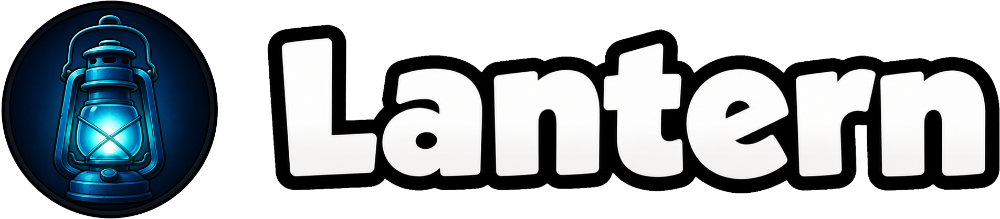
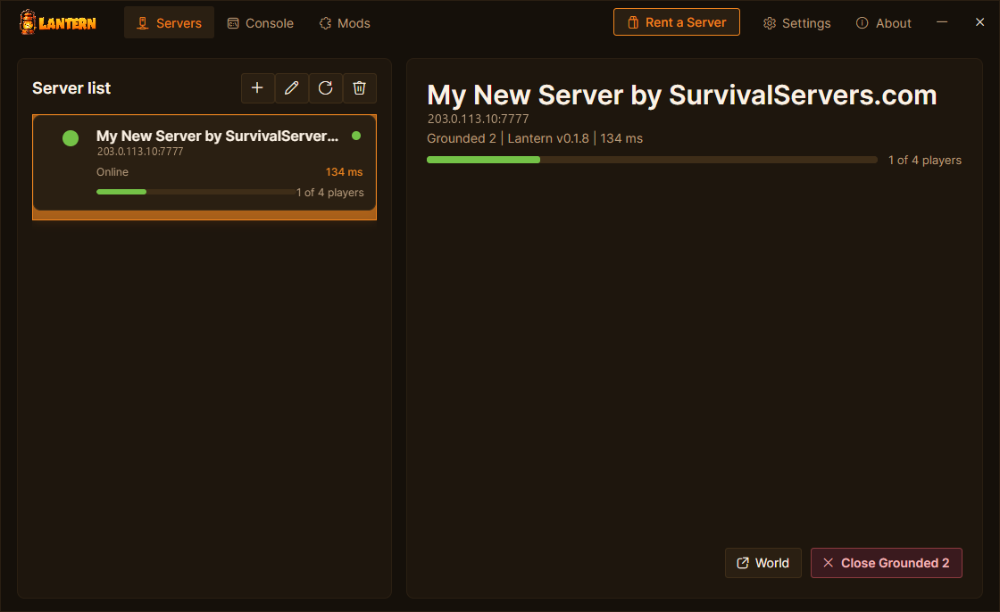
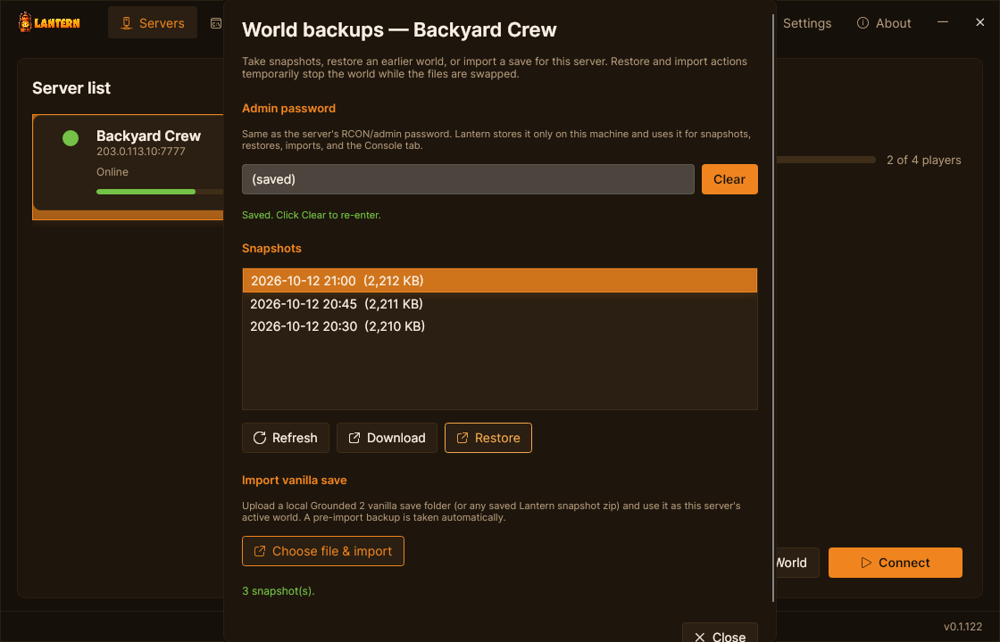
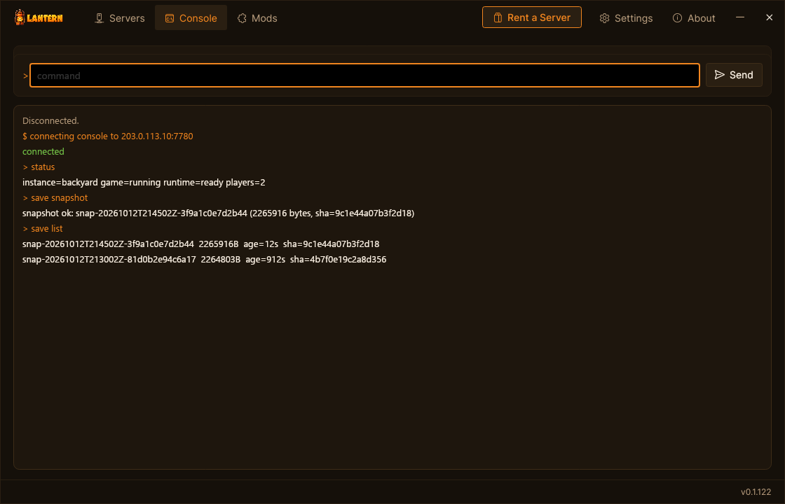

  <picture>
    <source media="(prefers-color-scheme: dark)" srcset="docs/img/lantern-lockup-dark.png">
    
  </picture>

  
  
  
  
  

# Lantern

Grounded 2 has no dedicated server. Its multiplayer runs inside one player's game, so the world is only online while that player is playing. Lantern adds a Grounded 2 dedicated server: [LanternServer](https://github.com/HumanGenome/LanternServer) runs the game headless on a Windows machine with a public IP and port, and the Lantern app connects players to it by address.

Every player must install Lantern to join a Lantern server. Stock Grounded 2 cannot connect to a Lantern server directly.

  

## Features

### 🏮 Join by address
Add the server's address and gameplay port in the app and click Connect. The app puts its join mod next to your game files, starts Grounded 2 and joins the server. The server list shows whether each server is up, its ping and how many players are on it. If the server has a password, the app asks for it once and checks it before it starts the game; on LanternServer 0.1.123 or newer, a player without the right password is sent back to the menu.

### 💾 World backups
LanternServer keeps snapshots of the world: on every autosave by default on a self-hosted server, and on demand with `save snapshot`. On servers running LanternServer 0.1.122 or newer, the app's World window lists them, rolls the world back to one, or uploads a Grounded 2 save from your own PC so the group carries on from it on the server. It asks before it replaces the world.

  

### 🖥️ Console in the app
The Console tab talks to the server's RCON port with the admin password: `status`, `players`, `save snapshot`, `save list`, `say`, `announce` and `motd`, without a separate RCON tool.

  

### 📡 Server query
LanternServer answers Source A2S query, so server lists, monitoring tools and Discord bots can read the server's name, status and player count.

### 🔄 Updates itself
The app checks for new versions while it runs, verifies each signed download and installs it when you close the app.

### 🧩 Mods
UE4SS Lua mods load on both the server and the players' games. See [docs/MODS.md](docs/MODS.md).

## Install

### Managed hosting
[SurvivalServers.com Grounded 2 hosting](https://www.survivalservers.com/services/game_servers/grounded2/?utm_source=github&utm_medium=readme_install&utm_campaign=lantern) runs LanternServer for you, handles the ports and updates, and its panel gives players a one-click Lantern setup link.

### Players
Lantern works with the Steam version of Grounded 2 on Windows. Xbox, PlayStation and Game Pass or Microsoft Store copies cannot join a Lantern server.

1. Download `LanternSetup-latest.exe` from the [latest release](https://github.com/HumanGenome/Lantern/releases/latest).
2. Run the installer. Windows SmartScreen may warn because the installer is not code-signed; choose **More info**, then **Run anyway**.
3. Open Lantern, click **+**, enter the server's address and gameplay port, then select it and click **Connect**.

### Self-hosted servers
Download `LanternServer-v<version>.zip` from the [latest LanternServer release](https://github.com/HumanGenome/LanternServer/releases/latest). The host needs its own copy of Grounded 2 from Steam, a public IP and open ports. Setup, settings, ports and RCON commands are in [HumanGenome/LanternServer](https://github.com/HumanGenome/LanternServer) and [docs/ADMIN.md](docs/ADMIN.md).

## Releases

This release page carries the player downloads:

- `LanternSetup-<version>.exe`: installer
- `LanternSetup-latest.exe`: the same installer at a link that never changes
- `Lantern-Launcher-Windows-x64-v<version>.zip`: the app without an installer
- `checksums-launcher.txt`: SHA-256 hashes for the files above

The server package (`LanternServer-v<version>.zip`) is published on the [LanternServer release page](https://github.com/HumanGenome/LanternServer/releases/latest). To play on someone else's server you only need the installer.

## Source

The server's .NET source is public at [HumanGenome/LanternServer](https://github.com/HumanGenome/LanternServer). The app and the in-game runtime ship as release binaries from this repo.

## FAQ

### Which copy of Grounded 2 do players need?
The Steam version on a Windows PC. Lantern is built and tested against the Steam release, so Xbox, PlayStation and Game Pass or Microsoft Store copies cannot join, and neither can crossplay friends on those platforms.

### How do I join a server?
Open Lantern, click **+**, and enter a name, the server's IP or hostname, and its gameplay port. Lantern finds the query, RCON and admin ports from the gameplay port, so you enter only the one port. Select the server and click **Connect**.

### Does it change my game?
Lantern installs UE4SS and its join mod into the Grounded 2 game folder when you connect. It does not change the game's own files, and Steam updates the game as usual.

### Can I bring my own world?
Yes, on a server running LanternServer 0.1.122 or newer: open the server's **World** window in the app and upload a zip of the save folder from your PC. The server keeps a copy of the current world first and restarts on the uploaded one. On a hosted server, your host can also place it for you.

### Can I run the server on the PC I play on?
Run it on a separate machine. The server runs its own copy of Grounded 2, and Steam allows one running copy per account.

### Is Linux supported?
No. The app and the server are Windows only (Windows 10/11 or Windows Server, 64-bit), because the server runs the Windows build of Grounded 2.

### Is this official?
No. Lantern is an independent project. Obsidian Entertainment does not ship dedicated servers for Grounded 2.

## Contributing

Bug reports and feature requests go in [GitHub Issues](https://github.com/HumanGenome/Lantern/issues). Include the Lantern version from the About screen and, for a join problem, the log from `%APPDATA%\Lantern`. Security problems go through [private vulnerability reporting](https://github.com/HumanGenome/Lantern/security/advisories/new), not a public issue. Questions about a hosted server go to your hosting provider.

## Community note

Lantern is an independent community project. It is not affiliated with, endorsed by, or supported by Obsidian Entertainment or Xbox Game Studios.

## License

[MIT](LICENSE).

## Credits

- [UE4SS](https://github.com/UE4SS-RE/RE-UE4SS): Unreal Engine scripting and modding framework
- [Avalonia](https://avaloniaui.net/): the .NET UI framework the app is built on
