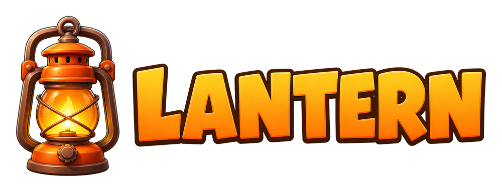
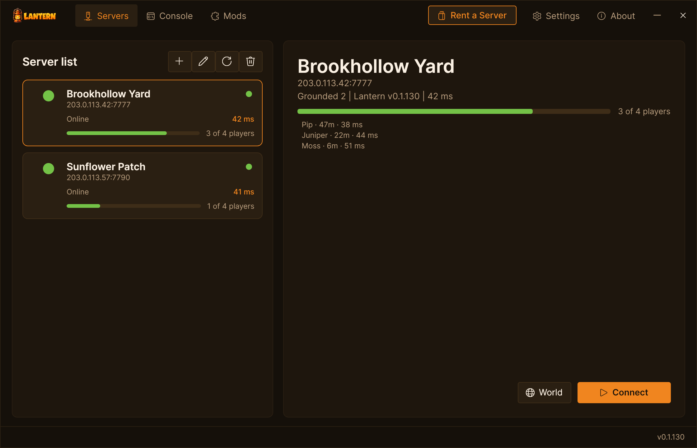
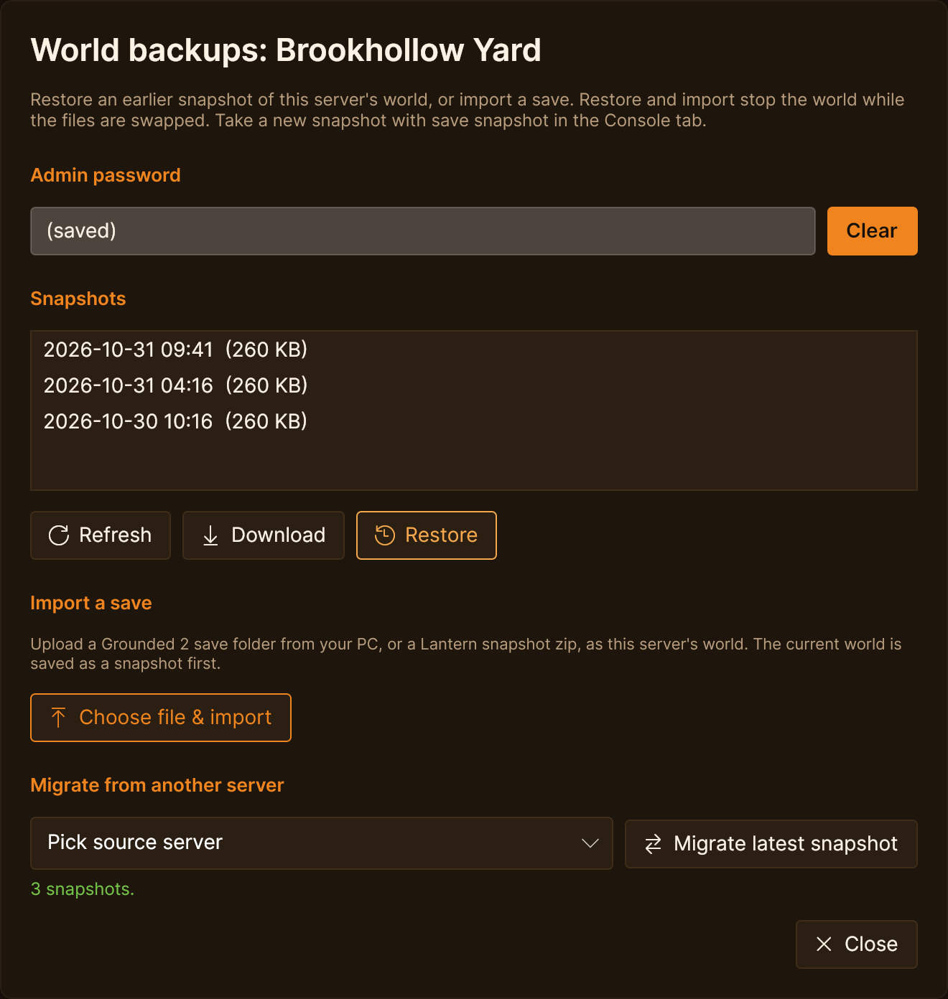
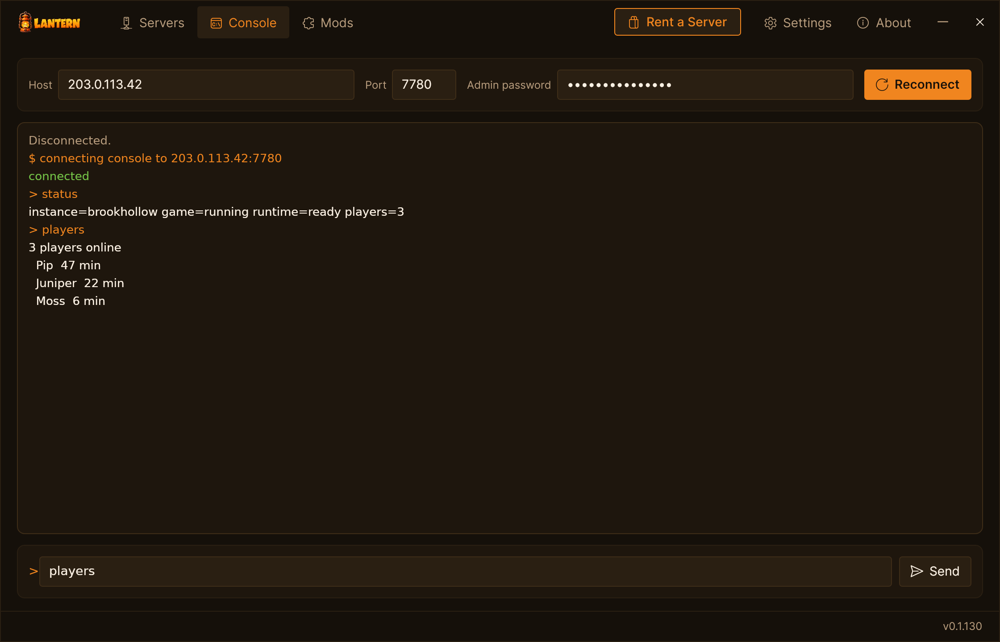

  <picture>
    <source media="(prefers-color-scheme: dark)" srcset="docs/img/lantern-logo-dark.png">
    
  </picture>

  
  
  
  

# Lantern

Grounded 2 has no dedicated server. Its multiplayer runs inside one player's game, so the world is only online while that player is playing. Lantern adds a Grounded 2 dedicated server. Players join it by IP with the Lantern app.

Every player needs the Lantern app to join.

## Features

### 🏮 Join by IP
Add the server's IP and port in the app and press **Connect**. Lantern starts Grounded 2 and joins the server. The server list shows whether each server is up, how many players are on it and your ping. If the server has a password, the app asks for it once, then remembers it.

  

### 💾 World backups
Type `save snapshot` in the Console to back up the world. The server also backs it up before every restore or upload. The app's **World** window lists the backups, restores one, or uploads a Grounded 2 save from your PC. It asks before it replaces the world.

  

### 🖥️ Server console
Type admin commands in the app's **Console** tab with the server's admin password: `status`, `players`, `save snapshot` and `save list`. No separate RCON tool needed.

  

### Also on the server
- **Mods:** UE4SS Lua mods load on both the server and the players' games. See [docs/MODS.md](docs/MODS.md).
- **Shows up in server lists:** server lists, monitoring tools and Discord bots can read the server's name, status and player count.

## Install

### Rent a server
[SurvivalServers.com](https://www.survivalservers.com/services/game_servers/grounded2/?utm_source=github&utm_medium=readme_install&utm_campaign=lantern) runs Grounded 2 servers with LanternServer installed.

### Players
Lantern works with the Steam version of Grounded 2 on Windows. Xbox, PlayStation and Game Pass or Microsoft Store copies cannot join a Lantern server.

1. Download `LanternSetup-latest.exe` from the [latest release](https://github.com/HumanGenome/Lantern/releases/latest).
2. Run it. At "Windows protected your PC" choose **More info**, then **Run anyway**.
3. Open Lantern, press **+** and enter the server's IP and port. Select it and press **Connect**.

### Host your own
Not supported yet: the server download only works with the setup a hosting panel does around it ([details](https://github.com/HumanGenome/LanternServer#host-your-own)). Settings, ports and console commands for a rented server are in [docs/ADMIN.md](docs/ADMIN.md).

## Releases

Each release has:

- `LanternSetup-<version>.exe`: the installer
- `LanternSetup-latest.exe`: the same installer at a link that never changes
- `Lantern-Launcher-Windows-x64-v<version>.zip`: the app without an installer
- `checksums-launcher.txt`: SHA-256 hashes for the files above

The server download (`LanternServer-v<version>.zip`) is on the [LanternServer release page](https://github.com/HumanGenome/LanternServer/releases/latest).

## Source

The server's source is at [HumanGenome/LanternServer](https://github.com/HumanGenome/LanternServer). The app ships as release files from this repo.

## FAQ

### Which copy of Grounded 2 do players need?
The Steam version on a Windows PC. Xbox, PlayStation, Game Pass and Microsoft Store copies can't join, so crossplay friends on those can't either.

### How do I join a server?
Press **+** in Lantern and enter a name, the server's IP and its port. You only enter the game port. Lantern works out the others. Select the server and press **Connect**.

### How many players can join?
Up to 4. Grounded 2 has four kids to pick from, and the server doesn't take one for itself, so 4 players get 4 different kids.

### Does it change my game?
Lantern adds UE4SS and its join mod to the Grounded 2 game folder when you connect. Each connect also adds an intro-movie skip to the game's Game.ini and puts Lantern's Engine.ini in your Grounded 2 settings folder for the session. When the game closes, Lantern puts back the Engine.ini that was there before, or removes its own. It does not change the game's own files, and Steam updates the game as usual.

### Can I bring my own world?
Yes. In the server's **World** window, upload a zip of the save folder from your PC. The server backs up the current world first, then restarts on yours. On a rented server, your host can also load it for you.

### Can I run the server on the PC I play on?
No. Self-hosting is not supported yet (see Install), and a Lantern server runs its own copy of Grounded 2 on a separate machine.

### Does the app update itself?
Yes. It checks for a new version when it starts and every 5 minutes, and verifies each signed download. Then it restarts itself on the new version within seconds. If Grounded 2 is running or you're joining a server, it waits until the game closes.

### Is Linux supported?
No. The app and the server are Windows only (Windows 10/11 or Windows Server, 64-bit), because the server runs the Windows build of Grounded 2.

## Contributing

Bugs: open an [issue](https://github.com/HumanGenome/Lantern/issues) with your Lantern version (from About) and, for a join problem, the log from `%APPDATA%\Lantern`. Security problems go through [private reporting](https://github.com/HumanGenome/Lantern/security/advisories/new).

## Community note

Lantern is an independent community project. It is not affiliated with, endorsed by, or supported by Obsidian Entertainment or Xbox Game Studios.

## License

[MIT](LICENSE).

## Credits

- [UE4SS](https://github.com/UE4SS-RE/RE-UE4SS): Unreal Engine scripting and modding framework
- [Avalonia](https://avaloniaui.net/): the .NET UI framework the app is built on
